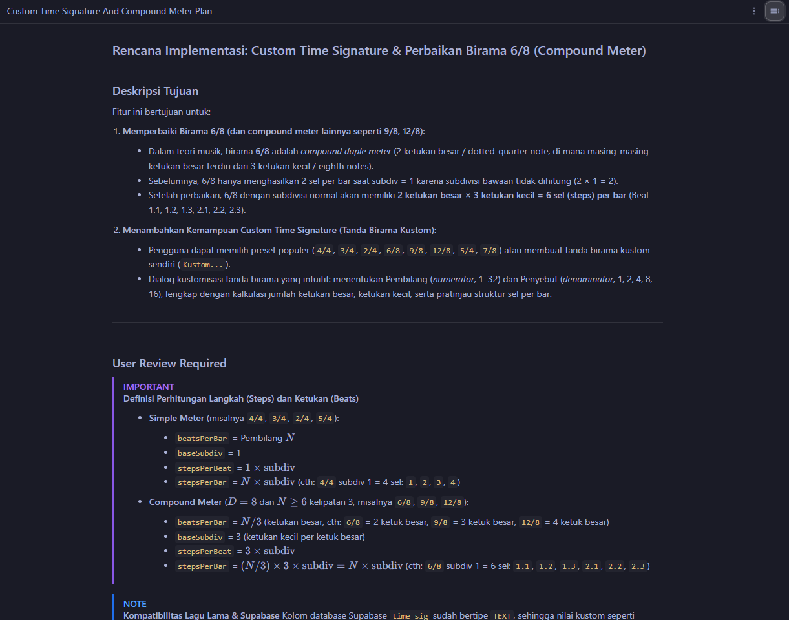

# Antigravity Plan Skill



An agent skill for writing reviewable implementation plans in the Antigravity
`implementation_plan.md` style. It explores the project, describes changes per
file, records decisions and blocking questions, and presents the full plan in
chat. It waits for approval before editing source files and saves a plan file
only when you explicitly ask.

## Install

Run from the project where you want to use the skill:

```sh
npx skills add jshsinaga/antigravity-plan-skill --skill antigravity-plan
```

The CLI prompts you to choose your coding agents. Add `-g` to install globally.
Requires Node.js 22.20 or later for the current skills CLI.

To inspect the available skill without installing it:

```sh
npx skills add jshsinaga/antigravity-plan-skill --list
```

## Update

After a new version is pushed, run the install command again to fetch the
current repository contents and replace the installed copy for the selected
agents. Installed copies do not refresh just because this repository changes.

You can also update the installed skill by name:

```sh
npx skills update antigravity-plan
```

Use `-g` if you originally installed globally. See the
[official update reference](https://github.com/vercel-labs/skills/blob/main/docs/commands.md#skills-update).

## Use

Ask your agent:

```text
Use antigravity-plan to plan adding password reset to this project.
```

The skill also describes automatic triggers for planning requests when your
agent supports skill discovery. Explicitly naming the skill is the most direct
way to select it.

The resulting plan includes:

- A goal description and optional problem background or architecture diagram.
- `User Review Required`, with alerts for decisions and risks.
- `Open Questions`, limited to blocking questions.
- `Proposed Changes`, grouped by component with `[NEW]`, `[MODIFY]`, and
  `[DELETE]` file entries.
- `Verification Plan`, with automated commands and manual checks.

Plans follow the language of your request while preserving the four anchor
headings in English. The agent's next planning response contains the full plan
directly in chat, with rendered Markdown headings and alerts. Answer questions
or request revisions in chat, then approve implementation.

To save a plan as well, explicitly ask for a file, for example:

```text
Save this plan to docs/plans/password-reset.md.
```

If you request a file without a path, the default is `implementation_plan.md`,
or `docs/plans/<slug>.md` when the project already uses that plans directory.
An existing plan file does not cause the agent to write to it automatically.

## Skill source

The complete instructions are in
[`skills/antigravity-plan/SKILL.md`](skills/antigravity-plan/SKILL.md).

For local discovery validation:

```sh
npx skills add . --list
```

This repository contains Markdown instructions, so there is no application build
or typecheck step.

## Directory

Install and discover skills through [skills.sh](https://skills.sh).
According to the [skills.sh publication FAQ](https://skills.sh/docs/faq), skills
are listed through anonymous installation telemetry from the skills CLI. There
is no separate package upload step; directory visibility can lag installation.

## Attribution

An independent, community skill inspired by Google Antigravity's planning
format. This project is not affiliated with or endorsed by Google.

## License

[MIT](LICENSE), copyright (c) 2026 Josua Sinaga.

## Example plan

The header image shows a plan for custom time signatures and compound meter.
The example below shows the Markdown source of a chat response in Bahasa
Indonesia, including the four English anchor headings, review decisions, file
changes, and checks. The agent renders this plan directly in chat; saving it
as a file requires an explicit request.

This example uses a fictional TypeScript metronome project. Its file paths,
symbols, and npm scripts are illustrative. For your project, the agent must
inspect the actual files and available commands before writing the plan.

````markdown
# Rencana Implementasi: Tanda Birama Kustom dan Perbaikan Birama 6/8

Perbaiki perhitungan birama 6/8 agar menghasilkan dua ketukan besar,
masing-masing berisi tiga langkah pada subdivisi normal. Tambahkan tanda
birama kustom agar pengguna dapat menentukan pembilang dan penyebut sendiri.

---

## User Review Required

> [!IMPORTANT]
> **Definisi ketukan dan langkah**
> Untuk cakupan fitur ini, birama dengan penyebut 8 dan pembilang minimal 6
> yang habis dibagi 3 diperlakukan sebagai compound meter: `beatsPerBar = N / 3`
> dan `stepsPerBeat = 3 * subdivision`. Birama lain memakai
> `beatsPerBar = N` dan `stepsPerBeat = subdivision`.
> Contoh: 6/8 dengan subdivisi 1 menghasilkan 2 ketukan besar dan 6 langkah.

> [!IMPORTANT]
> **Batas tanda birama kustom**
> Terima pembilang bilangan bulat 1 sampai 32 dan penyebut 1, 2, 4, 8,
> atau 16. Dialog menampilkan pratinjau jumlah ketukan dan langkah sebelum
> perubahan diterapkan. Pengelompokan khusus untuk birama seperti 7/8
> berada di luar cakupan fitur ini.

## Open Questions

- Apakah perubahan tanda birama saat metronom berjalan berlaku pada bar
  berikutnya atau langsung memulai ulang bar? Jawaban menentukan kapan
  `scheduleBar()` menerapkan konfigurasi baru.

---

## Proposed Changes

### 1. Perhitungan Birama

#### [MODIFY] `src/lib/time-signature.ts`

- Perbarui `calculateMeter()` untuk menghitung `beatsPerBar`,
  `stepsPerBeat`, dan `stepsPerBar` menurut definisi yang disetujui.
- Validasi pembilang, penyebut, dan subdivisi sebelum menghitung meter.
- Pertahankan hasil 4 langkah untuk birama 4/4 dengan subdivisi 1.

### 2. Penjadwalan Metronom

#### [MODIFY] `src/audio/metronome.ts`

- Gunakan hasil `calculateMeter()` di `scheduleBar()` agar seluruh
  langkah dalam bar dijadwalkan dan aksen mengikuti ketukan besar.
- Terapkan waktu pergantian birama sesuai jawaban pada `Open Questions`.

### 3. Pemilihan Tanda Birama

#### [NEW] `src/components/custom-time-signature-dialog.tsx`

- Sediakan input pembilang dan pilihan penyebut dengan batas yang disetujui.
- Tampilkan pratinjau ketukan dan langkah dari `calculateMeter()`.
- Tampilkan kesalahan untuk input tidak valid dan cegah penerapannya.
- Tombol Terapkan menyimpan pilihan; Batal menutup dialog tanpa perubahan.

#### [MODIFY] `src/components/time-signature-select.tsx`

- Tambahkan pilihan Kustom untuk membuka dialog.
- Tampilkan tanda birama yang dipilih setelah pengguna menerapkannya.

---

## Verification Plan

### Pengujian Otomatis

```sh
npm test
npm run lint
npm run typecheck
npm run build
```

- `src/lib/time-signature.test.ts`: uji 4/4, 6/8, 9/8, 12/8,
  subdivisi tambahan, dan penolakan input di luar batas.
- `src/audio/metronome.test.ts`: uji jumlah langkah, posisi aksen,
  dan waktu pergantian birama sesuai keputusan pengguna.
- `src/components/custom-time-signature-dialog.test.tsx`: uji
  pratinjau, validasi input, penerapan pilihan, dan pembatalan.

### Verifikasi Manual

1. Pilih 6/8 dengan subdivisi 1. Pastikan setiap bar berisi 6 langkah
   dengan aksen pada langkah pertama dan keempat.
2. Buka Kustom, isi 7/8, lalu pilih Terapkan. Pastikan pilihan menjadi
   7/8 dan pratinjau menampilkan 7 ketukan serta 7 langkah.
3. Masukkan pembilang 0 atau 33. Pastikan pesan validasi tampil dan
   pilihan tidak dapat diterapkan.
4. Ubah pembilang lalu pilih Batal. Pastikan tanda birama sebelumnya
   tetap aktif.
5. Saat metronom berjalan, ganti tanda birama. Pastikan waktu
   penerapannya mengikuti keputusan yang disetujui pada Open Questions.
````
