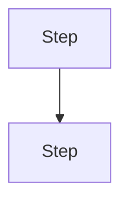

# Antigravity Plan

Produce an implementation plan in the structure used by Google Antigravity's planning mode. The format works because it separates *what needs a human decision* (review and open questions) from *what will change* (per-file entries) from *how to prove it works* (verification). A reader can approve or reject the plan in two minutes without reading code.

## Workflow

1. **Explore first.** Read the relevant code, schema, and existing tests before writing. A plan that names real files, functions, and constraints is useful; a generic one is not.
2. **Write the plan** to `implementation_plan.md` (project root, or `docs/plans/<slug>.md` if the repo already has a plans folder). If the tool can only reply in chat, output it inline.
3. **Stop and ask for review.** Do not edit source files until the user approves. If the user answers Open Questions or requests changes, update the same plan file instead of creating a new one.
4. After approval, implement section by section following `Proposed Changes`, then run the `Verification Plan`.

## Language

This skill file is written in English, but the plan it produces must be written in the user's language (the language of their request, unless they ask for another).

- Write all prose, alert text, bullets, and manual verification steps in the user's language.
- Keep these four anchor headings in English in every language, because tools and readers rely on them: `User Review Required`, `Open Questions`, `Proposed Changes`, `Verification Plan`.
- Translate every other heading (the title, optional sections, component names, and the Automated/Manual sub-headings) into the user's language.
- Keep code, file paths, commands, and identifiers exactly as they are in the project.

## Template

Use this structure, in this order. Separate major sections with `---`. Bracketed text is a placeholder to replace, and headings marked "translate" follow the Language rules above.

````markdown
# [Plan Title]                                   <!-- translate -->

[1-3 sentences: what is being built or fixed, and why. State the outcome, not the process.]

---

## Problem Description & Goals                    <!-- optional, translate -->
<!-- Include for non-trivial or bug-driven changes; omit for small ones. -->

### Background                                   <!-- translate -->
[Numbered list of the concrete causes or gaps in the current system.]

### Goals                                        <!-- translate -->
[Numbered list of what will be true after the change.]

---

## User Review Required

> [!IMPORTANT]
> **[Decision or definition needing approval]**
> [Rules, formulas, or behavior the user must confirm before work starts.]

> [!WARNING]
> **[Destructive or risky action]**
> [What is lost or hard to undo, and the safeguard.]

> [!NOTE]
> **[Compatibility or migration info]**
> [Why existing data or behavior stays safe, e.g. no DB migration needed.]

## Open Questions

[Blocking questions for the user, one per bullet. If none, write one line saying there are no blocking questions and why.]

---

## [Flow / Architecture]                         <!-- optional, translate -->



---

## Proposed Changes

### 1. [Component or Layer Name]                  <!-- translate -->

#### [MODIFY] [`path/to/file.ext`](file:///absolute/path/to/file.ext)
- [What changes, at behavior level. Name the functions, types, or queries involved.]
- [Next change in this file.]

```lang
// Only for contracts that are easy to get wrong: signatures, SQL, route registration, types.
```

#### [NEW] [`path/to/new-file.ext`](file:///absolute/path/to/new-file.ext)
- [Purpose of the file and its public surface.]

#### [DELETE] [`path/to/old-file.ext`](file:///absolute/path/to/old-file.ext)
- [Why it is safe to remove.]

---

### 2. [Next Component or Layer Name]
...

---

## Verification Plan

### Automated Tests                              <!-- translate -->
[Exact commands in fenced code blocks, then the test files to add or update, one line each saying what each covers.]

### Manual Verification                          <!-- translate -->
1. [Concrete step the user can perform and the exact result to expect.]
2. ...
````

The `<!-- ... -->` comments are guidance for you; do not copy them into the plan.

## Rules for each part

**Title and summary.** Title follows the pattern "Implementation Plan: <Feature>" (translated). The summary says what and why in plain words.

**User Review Required.** Use GitHub alert blockquotes. Each alert has a bold title line, then the body. Pick the type by meaning:
- `[!IMPORTANT]`: a definition, formula, or design choice that changes the result if the user disagrees.
- `[!WARNING]`: data loss, irreversible operations, security or integrity risk.
- `[!NOTE]`: reassurance or context (backward compatibility, no migration).

Include only alerts that carry a real decision or risk. An empty or filler alert trains reviewers to skip the section. The alert markers themselves (`[!IMPORTANT]` etc.) stay in English.

**Open Questions.** Only questions that block the plan. If the user already chose an approach, say so instead of reopening it.

**Diagram.** Prefer `sequenceDiagram` for request and transaction flows and `flowchart TD` for data or component flow. Keep node labels short. If the target tool cannot render mermaid, keep the block anyway; it still reads as structured text.

**Proposed Changes.**
- Group by layer or component (data model, store, service, handler/router, API contract, UI, tests), numbered `### 1.`, `### 2.`, in dependency order: lower layers first, so each section can build on the previous one.
- Each file gets a `####` header: `[MODIFY]`, `[NEW]`, or `[DELETE]` (always in English), then a markdown link whose label is the path in backticks.
- Link target is `file:///` plus the absolute path with forward slashes (for example `file:///d:/PROJECTS/app/src/lib/song.ts`). If the absolute path is unknown, or the tool is not Antigravity, use the repo-relative path in backticks without a link; do not invent absolute paths.
- Under each file, describe the change as short bullets. Reference real symbol names. Add a code block only when the exact signature, SQL, route, or type matters; never paste full implementations.
- Put test files in `Proposed Changes` only when the plan needs to explain them in detail; otherwise list them under `Verification Plan`.

**Verification Plan.**
- Automated tests list runnable commands exactly as they would be typed (`npm test`, `go test ./...`, lint, typecheck, build), plus new or updated test files with one line on what each checks.
- Manual verification is a numbered, user-executable script: where to click or call, and what must be observed. Cover the happy path, the cancel or negative path, and any destructive step.

## Quality checklist

Before presenting the plan, check:
- Every file path comes from code you actually inspected.
- Every risky or irreversible step has a `[!WARNING]` and a confirmation or rollback story.
- Each Proposed Changes section can be implemented without reading the others out of order.
- Verification commands exist in the project (check `package.json`, `Makefile`, CI config).
- The plan's prose and translatable headings are in the user's language, and the four anchor headings are in English.
- The plan is as long as the change requires and no longer: a one-file bugfix needs a short plan with only the sections that apply.

## Porting to other tools

The format is plain markdown, so it transfers as-is. Adjust only these when the host tool differs:
- Keep the file name `implementation_plan.md` so the plan is discoverable.
- Replace `file:///` links with repo-relative backticked paths if links do not resolve.
- If the tool renders GitHub alerts poorly, the `> [!TYPE]` lines still read as labeled blockquotes; leave them in place.
